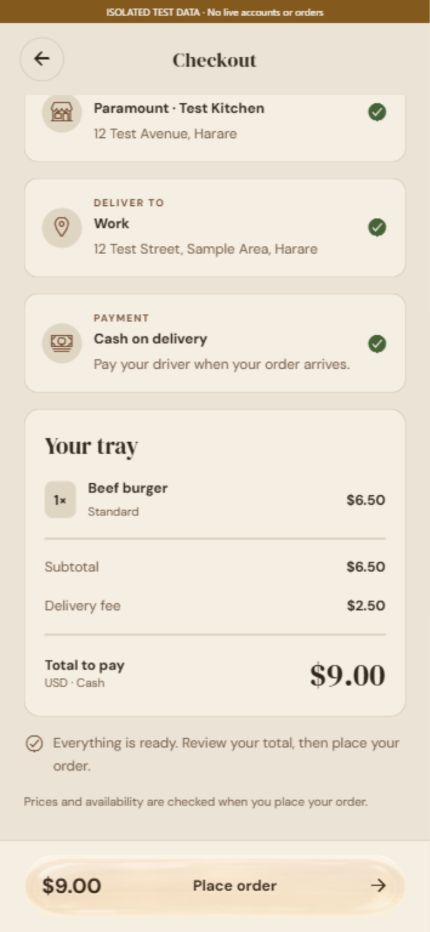
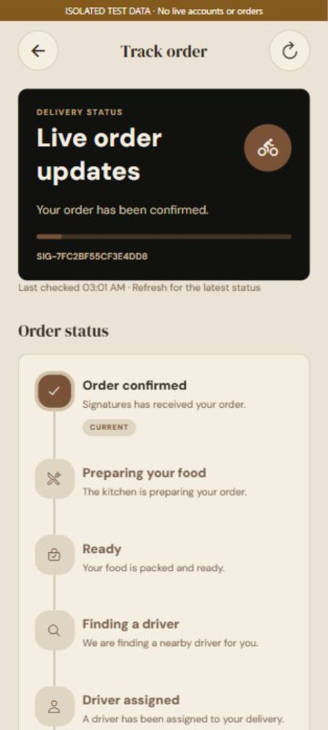
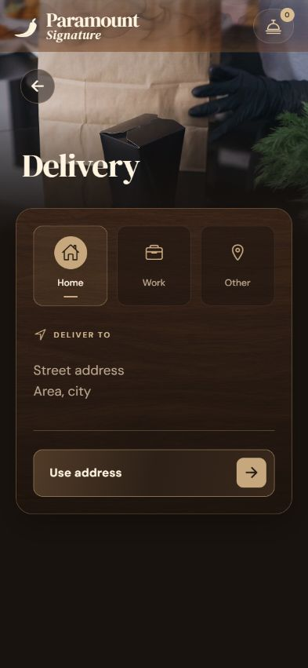

# Customer delivery UI — 8 November 2026

The address, checkout, payment and tracking screens retain the Paramount palette, fonts, shared press feedback and existing API flow.

## Changes

- Address: Home/Work/Other shortcuts, editable label, required-field feedback, address preview and keyboard-aware scrolling. The address belongs to the current checkout; this is not a saved-address book.
- Checkout: delivery/collection cards with accessible selected states, venue/address/payment completion indicators, itemised USD total and actionable guidance for missing details. Collection removes the delivery fee and hides the delivery-address card; switching back retains the entered address. Menu review after submission failure preserves the tray. UI preview disables submission explicitly.
- Payment: cash wording supports both delivery and collection.
- Tracking: working manual refresh replaces the inactive help icon; pull-to-refresh and last-checked feedback are included. Failed manual refreshes are caught and reported. Cancelled orders show Cancelled in the hero, collection uses a bag icon, and ready delivery orders refer to the driver. Content width and hero wrapping accommodate narrow screens.

## Verified in this session

- Customer TypeScript check passed after edits. Changed-screen whitespace check passed.
- Browser used the already-running localhost:8083 customer app and localhost:4010 disposable test service, visibly labelled ISOLATED TEST DATA. No live accounts or orders were involved.
- Empty address and whitespace-only label validation; Work shortcut; address preview; save back to Home.
- Checkout missing-payment guidance opened Payment. Cash selection enabled checkout.
- Collection changed USD 9.00 to USD 6.50 and removed the delivery address. Switching back restored the address and USD 2.50 fee.
- Submitted disposable delivery order SIG-7FC2BF55CF3E4DD8, reached confirmation and tracking, and completed a manual refresh.
- Mobile layouts reviewed at 360/362 and 430 pixels; document width matched viewport width. Tracking text stayed within the 360-pixel viewport. Address also reviewed at 1280 pixels with no document overflow.

## Limits

No hosted integration, physical-device checks, native keyboard/pull-to-refresh checks or network-failure injection were performed in this session. The disposable order was verified through confirmation and tracking; staff/driver progression was not repeated. No publication or GitHub push occurred.

## Captures

## Home styling revision

Following visual feedback, the customer test banner was removed. Address now reuses Home's Paramount header, grill video and poster, gold italic typography and rounded cream sheet. The existing delivery photo floats gently over the hero; motion stops for reduced-motion preference, background state and loss of focus. Header contrast changes as the form scrolls beneath it. Address shortcuts, validation, preview and saving remain intact.

Browser verification: banner absent; active address video playing while the underlying Home video was paused; empty-address feedback; Work shortcut; save returned to Home with the entered address. Reviewed at 360 pixels and 1184 pixels with matching document/viewport widths. Native device and live reduced-motion preference changes were not tested. The local test service still uses disposable data even though its banner is removed.

## Delivery visual revision — compact walnut treatment

Supersedes the Home-styled hero above. Delivery now uses locally bundled takeaway-packing footage by Mikhail Nilov (Pexels 6613037); see assets/paramount/SOURCES.md for provenance. Home and Bar footage are unchanged. Removed the bag sticker, promotional headings, supporting paragraphs and duplicate address preview. Replaced the cream form with a textured dark walnut panel, brass selection indicators, minimal address input and a rectangular walnut/brass action. Custom naming appears only for Other.

Verified: TypeScript and changed-file whitespace checks passed; browser layouts at 360, 393 and desktop widths; no horizontal overflow at 360/393; required-address error; Other -> Studio custom label; saved test address appeared on Home. The delivery-packing video was playing while Home's grill video was paused. The restarted localhost:8083 session is UI-preview mode, with sample menus and no account/order creation. Native rendering, native keyboard and live reduced-motion switching were not tested in this revision.

## UI polish pass — 22 November 2026

UI-only changes; hero videos, AtmosphereVideo, ParamountHero and existing motion are untouched. Originals of every edited file are in `apps/customer_app/customer-mobile/.cache/ui-polish-backup/`.

- Primary actions (Add to cart, Checkout, Place order, Log in, Track, Order something, selected chips) use a new solid `colors.cta` espresso fill with a brass hairline instead of the pale glass material.
- Food details: header price follows size/extras; the empty rating star is hidden when a dish has no rating.
- Search: category chips come from the menu's real categories; results show the selected venue name.
- Checkout: cash (the only method) is pre-selected; an 18+ ID note appears when the tray contains Bar items.
- Bar: hard-edged brutalist finish (2px bone borders, brass offset shadows, numbered tiles, square dock variant), placeholder prices, serve options (single/six-pack, bottle, regular/double), quantity and Add to tray, confirmation toast, tray button, session 18+ gate. Mixed-background bottle photos sit in a uniform framed print. Bar prices are UI-preview placeholders.
- Tracking: fixed visual stage behind a scrolling cream sheet. Grill video while cooking, packing video at handover, stylised route map with moving rider on the road, delivered state. Live countdown, four-step stepper, pulsing live tag. The route position is estimated from the ETA (no driver GPS yet).
- UI preview: Orders empty state offers "Preview live tracking" (sample order `SIG-PREVIEW-0001`) with stage buttons on the tracking screen; preview skips API polling.

Verified in the browser preview: TypeScript passes; Home grill video plays; age gate, Bar add-to-tray (six-pack/single) to cart and checkout; size pricing; search categories and venue label; tracking stages preparing → on the way → delivered with grill/packing video switching. Not tested on a physical device.

## Tracking redesign and extras — 22 November 2026 (second pass)

- Tracking is now fully dark and cinematic (`order-tracking/components/TrackingExperience.tsx`, `TrackingStage.tsx`): grill video with drifting embers while cooking, packing video at handover, full-bleed night-city map with glowing ember route, moving rider, pulsing home pin and "arriving in" bubble on the road. Below: ember "Hot & fresh" status card, arrival ring with countdown and "arriving by" time, four-step stepper, rider card (call/message buttons show a note until the driver app shares contact details), glass order card with dish photos, expandable "Every step" timeline.
- Notices: "Running a little late" when a new estimate is >3 min later than expected; "New rider assigned" when the driver changes. Preview has "simulate delay" and "reassign rider" buttons.
- Kitchen copy names the dish ("Your Signature Beef Burger and 1 more dish are being cooked now").
- Reorder: delivered orders get "Order this again" (tracking) and "Reorder" (Orders history). Uses today's menu and prices; items no longer on the menu are skipped and named.
- Skeleton loaders replace spinners on Orders, Venue and Tracking (dark tone on tracking).
- Haptics: `components/haptics.ts` fires on add-to-cart, reorder and stage changes. Web uses the Vibration API; native needs `npx expo install expo-haptics` then the one-line change described in the file.
- Dish photos: `sample-data/dishPhotos.ts` gives 54 dishes their own Unsplash photo (visually checked). Put the restaurant's own photos in `ownPhotos` to override. Starches (Mhunga, Zviyo, White Sadza) had no stock match and keep the category photo. Live menu items without an `image_url` also fall back to these.

## Remaining customer screens — 22 November 2026 (third pass)

Cream + walnut remains the main theme; only the Bar (dark brutalist) and Tracking (cinematic) depart from it.

- Food details (live mode): `LiveFoodDetails.tsx` now matches the designed preview — rounded hero photo, favourite heart, serif title, live price per variant, option chips, branch line, unavailable notice, "choose a branch" prompt, sticky quantity + Add to cart bar, skeleton while the menu loads.
- Order confirmation: cream page with a walnut "ticket" — flame flare settles into a brass seal, serif "Order confirmed." with gold italic line, branch / items / total, then auto-opens live tracking after ~5 s (button shows progress; "Stay on this page" or "Back to home" cancels). UI preview can now place a local sample order from the real tray so checkout → confirmation → tracking is reviewable; nothing is sent to the API.
- Profile: Personal details (read-only; editing needs an API), Favourites (hearts on Food details, saved per customer on device), Notifications (preferences saved on device; push delivery not yet built), Settings (haptics toggle wired to `components/haptics.ts`, motion info, in-page log-out confirm that also works on web where `Alert` does not).
- Auth: grill video hero with Paramount wordmark, "Welcome back." / "Good food is waiting.", Log in / Create account segmented control, uppercase field labels, show/hide password, outlined secondary preview button.
- Venues: details from public listings (see comment in `services/venuesApi.ts`): CBD (Cnr G.Silundika & 5th Str, +263 77 443 0419, listed 24 h), Borrowdale (72 Ridgeway North, 10:00–21:00), Hatfield (Seke Road, +263 77 259 1113, 11:00–05:00). Chitungwiza has no public listing — shows "Branch details coming soon". Cards show open-now status, hours, call and Google Maps directions.
- Bar prices: aligned to Harare bar & grill rates (local lagers $2.50, imported $3–4.50, ciders $3, cocktails $7–8); spirits/wine bottles remain estimates.
- Starches: White Sadza, Mhunga, Zviyo use the closest stock image (a maize-meal block); replace with real photos.
- Menu hero video re-rendered: dish centred and smaller so phones show it whole; grey cut-out edges removed.
- Payment left unchanged (Touch Africa integration pending). Phone testing still outstanding.

## Ordering extras and flat-finish cleanup — 22 November 2026 (fourth pass)

UI-only. Originals of every edited file are in `apps/customer_app/customer-mobile/.cache/ui-polish-backup-pass4/`. Features that need backend work run on local mocks and are switched on in the UI preview only, via `src/services/mockFeatures.ts` (each flag names the endpoint it needs). Mocks live in `src/services/mockApi.ts`, `src/sample-data/dishDetails.ts` and `src/sample-data/mealDeals.ts`.

- **Tray bar** (`components/TrayBar.tsx`): once the tray has items, a solid espresso bar ("View tray · 3 · $23.85") sits above the dock on Home and the menu and goes straight to checkout. The header tray icon is unchanged.
- **Customise meal** (`features/food/components/CustomiseMeal.tsx`): "No …" chips for ingredients taken from the menu description (burgers, wraps, salads, breakfast) and paid add-ons per category (e.g. Extra cheese +$1). Shown alongside size; the old extras list is now "On the side". Choices show on cart, checkout and tracking lines ("Small · Extra cheese · No greens"). Needs: modifiers on the menu API and on order items. Add-on prices are placeholders.
- **Ingredient line**: small-caps line under dish names on Home, menu, search and food details ("BEEF · CHEESE · HOUSE MAYO"); replaces the paragraph on food details. Hand-written for most dishes, otherwise shortened from the description; dishes with no description show none. The menu says "cheese", not "cheddar", so the line does too.
- **Meal deal card** on Home: one flat walnut card, Combo + fries + drink, $16 (save $2) — placeholder price. Hidden in live until the branch confirms (`confirmedByBranch`).
- **Reorder strip** at the top of the Home sheet: last delivered order with a Reorder button (uses the existing reorder logic, then opens the tray). Preview falls back to the sample order.
- **Promo code** (`features/cart/components/PromoRow.tsx`): one collapsed row in the cart; discount carries to the tray bar, checkout and tracking. Sample codes SIGNATURE10 (10%) and WELCOME5 ($5 off $25+). Only worth enabling if the restaurant runs codes.
- **Rate your order**: after delivery the tracking screen shows 1–5 stars (one tap saves) and an optional note. Ratings are stored per customer on the device (`context/RatingsContext.tsx`) and feed the ★ averages on Home, menu, search and food details, and the Popular sort. Needs: a ratings endpoint and server-side averages.
- **Book a table** (`features/booking/screens/BookTableScreen.tsx`): branch, date (14 days), half-hour seatings from 12:00 to an hour before close, party size 1–20, name/phone, optional note; confirmation panel with a reference. Entry points: Home row and "Book a table" on each venue card. Needs: a table-request endpoint and a branch-dashboard inbox.
- **Cleanup**: confirmation glow removed; Bar tile and drink-detail backgrounds are flat; dark gradient overlays on walnut panels (Home branch card, sub-page WoodPanel, confirmation ticket, delivery address panel and its button, the dock) replaced with flat tints. Gradients still left: Home hero (kept by request), Bar/Auth/Address hero scrims over video, header BraaiWood ember glow (still animates), ParamountGlass, and the pulsing pins in tracking.

Verified in the browser preview at 375 px: TypeScript passes; reorder → tray; invalid and valid promo codes; tray bar on Home and menu; menu ingredient lines; customise → cart line; meal deal → checkout → confirmation (no glow) → tracking → delivered → 4-star rating; book a table (Borrowdale seatings stop at 20:00, validation, sent state); flat Bar tiles. Note: changing branch empties the tray (existing behaviour). Not tested on a phone.

- CBD address changed to "Cnr G.Silundika & 5th Str" (was "Just off Seke Road"); the Directions link now searches George Silundika Avenue & Fifth Street instead of the old plus code.

## Follow-up — 22 November 2026 (fifth pass)

- Book a table removed from the UI (Home row, venue-card action, route, mock). The first draft is parked in `customer-mobile/.cache/parked/booking/` for when it is redesigned.
- Meal deal card moved from Home to the menu page (top of All and Burgers), since Home's favourites already show the dishes.
- Removed the "Prepared your way" note at the bottom of the menu.
- Skeletons: Home favourites, menu grid and search results show dish-shaped skeletons while a live menu loads (replacing the "Loading venue menu…" text); the session check at launch shows a Home-shaped skeleton instead of a spinner. (The UI preview menu loads instantly, so these only appear against the live API.)
- Tracking preview: stage buttons now assign the sample rider from "ready" onwards and clear it before, so "Finding your rider" changes to the rider card as it would live (live updates come from the 15-second poll once the driver app accepts the delivery).
